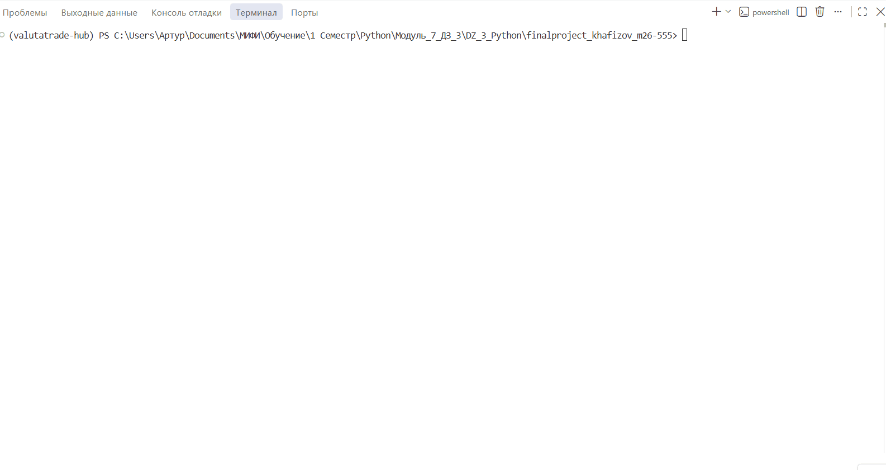

# ValutaTrade Hub

Учебный проект Khafizov Arthur, группа m26-555. Python 3.12, uv, JSON, PrettyTable,
Requests, Ruff. Это симулятор; реальные деньги и биржевые ордера не используются.

## Установка и запуск

```powershell
uv sync --locked
uv run project --demo
```

`--demo` использует вымышленные постоянные курсы и отдельные `data_demo/`,
`logs_demo/`. Для реальных API запустите `uv run project` без этого флага.
Сессия login живёт до выхода из приложения. Команды после `vth>` вводятся
внутри одного запущенного приложения, без префикса `uv run`.

## Модель сделок

Выбрана полная модель, разрешённая пояснением преподавателя. Регистрация создаёт
пустой портфель. `deposit --amount 10000` выдаёт учебные USD. `buy` списывает
`amount * rate` USD и добавляет `amount` единиц валюты. `sell` делает обратное.
Нехватка USD или продаваемой валюты вызывает `InsufficientFundsError`.
Комиссий нет. USD является расчётной валютой: buy/sell USD запрещены.
Суммы имеют тип float по ТЗ; для настоящих денежных расчётов потребовался бы Decimal.

## Пример команд

```text
register --username alice --password 1234
login --username alice --password 1234
show-portfolio
deposit --amount 10000
update-rates
buy --currency BTC --amount 0.05 --yes
sell --currency BTC --amount 0.01 --yes
show-portfolio --base USD
get-rate --from USD --to BTC
show-rates --top 2
show-rates --currency RUB --base EUR
show-history
currencies
help get-rate
logout
exit
```

Без `--yes` сделку нужно подтвердить ответом `y`. `--amount` задаёт количество
покупаемой или продаваемой валюты, не сумму в USD. В дробях используется точка.

## Реальные API

Получите ключ ExchangeRate-API на https://www.exchangerate-api.com/ и бесплатный
Demo-ключ CoinGecko в кабинете https://www.coingecko.com/en/api.
В том же PowerShell перед запуском задайте переменные окружения:

```powershell
$secret = Read-Host 'Ключ ExchangeRate-API' -AsSecureString
$env:EXCHANGERATE_API_KEY = [Net.NetworkCredential]::new('', $secret).Password
$secret = Read-Host 'Ключ CoinGecko Demo' -AsSecureString
$env:COINGECKO_API_KEY = [Net.NetworkCredential]::new('', $secret).Password
Remove-Variable secret
uv run project
```

Ввод ключей скрыт; переменные окружения существуют в текущем PowerShell и его
дочерних процессах. Сам по себе файл .env программой не загружается. Ключи не
записывайте в исходники, README, Git или демо.
`update-rates --source coingecko` и `--source exchangerate` обновляют один источник.
Без `--source` запрашиваются оба. Ошибка одного источника не удаляет старые курсы
и не мешает сохранить успешный ответ другого. Если не ответил никто, обновление
заканчивается ошибкой. Лимиты и период обновления зависят от тарифа провайдера.

## Кэш и история

`data/rates.json` имеет ключ `pairs`, внутри - пары вида EUR_USD с `rate`,
`updated_at`, `source`. Rate означает число единиц второй валюты за одну первую.
USD_EUR из ответа ExchangeRate-API инвертируется в EUR_USD. Кросс-курс A_B равен
A_USD / B_USD. `updated_at` - время успешного получения данных приложением в UTC;
время самого провайдера, если доступно, находится в metadata истории.
TTL по умолчанию 300 секунд относится к получению данных, но не к частоте пересчёта
цен поставщиком. Здесь нет обещания биржевых котировок в реальном времени.

`get-rate`, сделки и оценка портфеля при устаревании пытаются обновить данные один
раз, затем проверяют нужные пары снова. `show-rates` читает кэш без сети и явно
помечает устаревшие записи. В кросс-курсе свежими должны быть обе составляющие.
`--top N` означает N криптовалют с самой высокой ценой одной монеты, не по капитализации.
`data/exchange_rates.json` - список исторических измерений, ID = пара + ISO-время.
Повтор ID не добавляется; старое измерение не вытесняет новое. Metadata содержит
сравнение с предыдущим курсом. Успешные сделки и пополнения - в `transactions`
внутри `portfolios.json`; технические события и ошибки располагаются в логах.

## Структура

```text
valutatrade_hub/
  core/             currencies.py exceptions.py models.py utils.py usecases.py
  infra/            settings.py database.py
  parser_service/   config.py api_clients.py storage.py updater.py scheduler.py
  cli/              interface.py
  decorators.py
  logging_config.py
main.py
tests/test_project.py
```

Все каталоги пакетов содержат `__init__.py`. Данные и логи создаются в рабочей
папке запуска, не внутри установленного пакета. При запуске из другой папки
по умолчанию появляется отдельный набор данных. `--data-dir` задаёт явный путь.

## Настройки и ограничения

Порядок: значения по умолчанию → `[tool.valutatrade]` в pyproject.toml → config.json
в рабочей папке → VTH_DATA_DIR, VTH_LOG_DIR, VTH_RATES_TTL_SECONDS из окружения.
SettingsLoader и DatabaseManager - Singleton через `__new__` в одном процессе.
После изменения настроек перезапустите приложение. Встроенный JSON-кэш чтения
использует замыкание, проверяет время изменения файла и возвращает копии данных.

Файлы записываются через временный файл и os.replace; порча JSON не скрывается
заменой пустыми данными. Атомарность обеспечивается отдельно для каждого файла.
Не нужно ожидать транзакционности СУБД. Для одной папки данных допускается один пишущий
процесс. Закройте CLI перед отдельным планировщиком, остановите планировщик перед
возвратом в CLI. PostgreSQL для этого задания не требуется.

SHA-256 с солью реализован по учебному ТЗ. Подчёркивание в имени поля - соглашение Python о внутреннем атрибуте.

Логи `logs/actions.log`, `logs/parser.log` - JSON по одной записи в строке,
уровень INFO, ротация при 1 МиБ, 3 резервных файла. Пароли и ключи не логируются.
`@log_action` применяется к buy/sell, фиксирует успех и ошибку и пробрасывает
исключение в CLI. `verbose=True` добавляет балансы до и после.

## Проверка и сборка

```powershell
uv run ruff format --check .
uv run ruff check .
uv run python -m unittest discover -s tests -v
uv build
```

Makefile содержит install, run, lint, format, test, build. В Windows без make
используйте соответствующие полные команды uv. Публикация в PyPI не нужна.
Отдельный парсер: `uv run python -m valutatrade_hub.parser_service.scheduler --once`.
Для периодического запуска уберите --once; интервал по умолчанию 3600 секунд,
флаг `--interval` задаёт секунды. Остановка Ctrl+C. Частоту согласуйте с тарифами.

## Демонстрация


